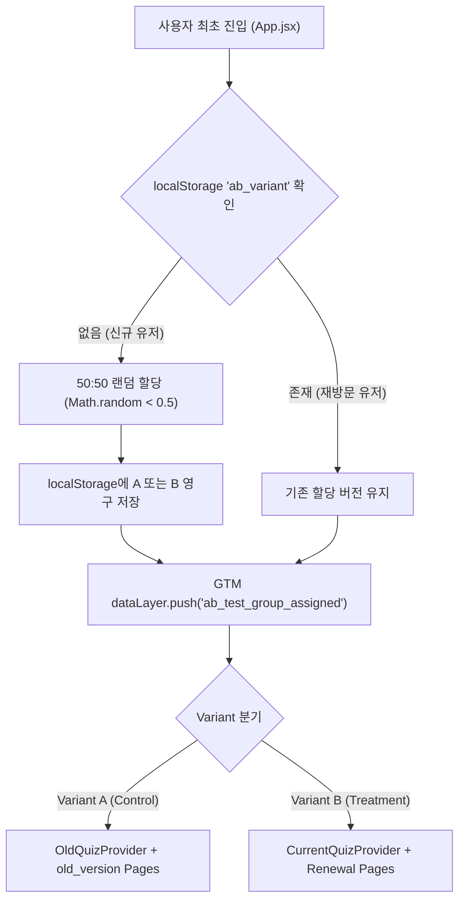

# 🐶 너의 댕댕이는 (나의 취향저격 댕댕이는?)

> **데이터 기반 반려견 성향 매칭 테스트 & 유기견 보호소 연결 플랫폼**  
> 단순 바이럴 심리테스트를 넘어 **GTM · GA4 · BigQuery 이벤트 파이프라인 구축**과 **가설 기반 클라이언트 A/B 테스트**를 통해 사용자 전환율·완주율·공유율을 정량적으로 검증하고 개선한 프로젝트입니다.


- **핵심 역량 포인트**: `Product Analytics` · `A/B Testing` · `Event Taxonomy 설계` · `Frontend Engineering`

---

## 1. 프로젝트 개요

### 기획 배경 및 목표
- **비즈니스 목적**: 13개 일상 시나리오 문항을 통해 사용자의 성향과 닮은 반려견(국내 친숙 반려견 24종)을 매칭해 주고, 결과 페이지에서 **수도권 유기견 보호소·봉사단체 정보 및 위치 지도**로 자연스럽게 유입을 유도합니다.
- **데이터 및 실험 목적**: 서비스 배포 이후 퍼널별 이탈 구간을 측정하기 위해 **GTM → GA4 → BigQuery** 분석 파이프라인을 설계하고, UX 개선 가설을 검증하기 위한 **50:50 A/B 테스트 아키텍처**를 직접 구현했습니다.

---

## 2. 핵심 기능 및 매칭 로직

### 2.1 13차원 성향 벡터 기반 24종 견종 매칭 엔진
- **데이터 출처**: 국립축산과학원 '국내 친숙 반려견' 24종 및 한국애견협회(KKC) 견종표준 데이터
- **매칭 알고리즘** (`src/domain/match/rankDogs.js`, `src/domain/match/score.js`):
  1. 13개 문항 응답에 따라 13개 성향 축(`playful`, `confident`, `jealous`, `quickWitted`, `fearless`, `independent`, `lifelongFriend`, `gentle`, `friendly`, `outgoing`, `activitylevel`, `size`, `cheerful`)에 연속 가중치를 누적합니다.
  2. 사용자의 **상위 6개 핵심 성향 벡터**를 추출해 견종별 이진 성향 벡터와 위치 기반으로 합산 매칭합니다.
  3. 13문항 대칭 구조에서 특정 견종에 결과가 쏠리는 편차를 줄이기 위해 **견종별 초정밀 보정치(`CALIBRATION`)**와 **결정론적 타이브레이커(Deterministic Tie-breaker)**를 적용하여 동일 응답 시 항상 일관된 순위를 보장합니다.

### 2.2 성향 시각화 및 실시간 통계 (Recharts & Supabase RPC)
- **5대 감성 카테고리 Radar Chart**: 13개 성향을 `🔥 무한동력`, `🛡️ 강철멘탈`, `🐾 껌딱지`, `🌻 사랑둥이`, `🦊 눈치만렙` 5개 카테고리로 재그룹화 및 스케일링하여 직관적인 프로필 차트와 조합형 닉네임(2위 카테고리 형용사 + 1위 카테고리 명사)을 제공합니다.
- **실시간 DB 집계 (`src/lib/hooks.js`)**: Supabase PostgreSQL RPC 함수를 통해 참여자 수(`get_users_count`), 익명 사용자 등록(`register_new_user`), 설문 응답·매칭 결과 저장(`save_user_results`), 동일 견종 비율 Pie Chart(`get_sim1_ratio`), 서비스 별점(`save_user_critic`)을 실시간 처리합니다.

### 2.3 보호소 지도 연동 및 위치 편향(Position Bias) 제거
- **인터랙티브 지도**: `React-Leaflet`과 `OpenStreetMap(OSM)`을 활용해 수도권 5개 유기견 보호소·단체(다시사랑받개, 동물권행동 카라, 행동하는 동물사랑, 구리시 반려돌봄센터, 서울시립동물복지지원센터)의 위치 마커와 상세 카드를 제공합니다.
- **Fisher-Yates 셔플 & 노출 위치 로깅**: 카드가 고정된 순서로 노출될 때 발생하는 **상단 위치 편향(Position Bias)**을 제거하기 위해 마운트 시 Fisher-Yates 알고리즘으로 보호소 순서를 무작위 셔플하고, 실제 노출 순번(`location_id`)을 GTM 이벤트에 함께 기록합니다.

---

## 3. A/B 테스트 아키텍처 및 UX 개선 내역

### 3.1 클라이언트 사이드 샌드박스 격리 아키텍처 (`src/app/App.jsx`)
React SPA(Vite) 환경에서 서버 미들웨어 없이 안전하게 A/B 테스트를 운영하기 위해 **단일 진입점 분기 및 완전 격리(Sandbox) 구조**를 설계했습니다.



- **일관된 사용자 경험(Sticky Assignment)**: 최초 할당된 그룹을 `localStorage`에 영구 저장하여 새로고침 및 재방문 시에도 화면 혼선과 실험 데이터 오염을 방지했습니다.
- **상태 관리 충돌 원천 차단**: 화면 컴포넌트(`Landing`, `Quiz`, `Result`)뿐만 아니라 상태 저장소(`QuizProvider`)까지 A/B 버전별로 통째로 격리 교체하여 기존 버전과 신규 버전 간 의존성 충돌 가능성을 0%로 차단했습니다.

### 3.2 가설 기반 UX 개선 비교 (A안 vs B안)

| 퍼널 단계 | 핵심 지표 (목표) | A안 (Control - 기존) | B안 (Treatment - 개선) | 개선 가설 |
| :--- | :--- | :--- | :--- | :--- |
| **Landing** | 테스트 시작 전환율 | 장문의 출처 안내문, 단순 참여자 수 표기 | 핵심 문구 간소화, 실시간 후킹 배지(`🔥 지금 이 순간에도...`), CTA 상단 **소요시간 강조 말풍선(`⏱️ 단 2분 컷! 13개의 간단한 질문`)** 추가 | 인지 부하를 낮추고 낮은 참여 허들(2분)을 명시하면 시작 클릭률이 상승할 것이다. |
| **Quiz** | 퀴즈 완주율 / 이탈률 | 단순 프로그레스 바, 일부 특정 타깃 편향 문항(짝사랑, 동호회 파티 등) | **9번 문항부터 진행바 하단 응원 말풍선**(`🐾 앞으로 N문제! 거의 다 왔어요!`) 추가, 보편적 공감형 시나리오로 문항 리라이팅 | 후반부 잔여 문항 피드백과 높은 공감도의 문항이 중도 이탈을 줄일 것이다. |
| **Result** | 바이럴 공유율 | 카카오톡 공유·링크 복사 버튼이 페이지 최하단에 위치 | 공유 버튼 영역을 **1위 매칭 결과 카드 직후(최상단 핵심 영역)**로 재배치 | 결과 확인 직후 감정적 몰입이 최고조인 시점에 CTA를 노출하면 공유 전환율이 상승할 것이다. |

### 3.3 실험 결과 요약 *(집계 완료 후 수치 업데이트)*

| 지표 | A안 (Control) | B안 (Treatment) | 증감률 (Lift) | 비고 |
| :--- | :---: | :---: | :---: | :--- |
| 랜딩 → 퀴즈 시작 전환율 | `- %` | `- %` | `- %p` | BigQuery `events_*` 기준 |
| 퀴즈 완주율 (1번 → 13번) | `- %` | `- %` | `- %p` | `click_answer_quiz` 단계별 퍼널 |
| 결과 공유율 (카카오톡 / 링크) | `- %` | `- %` | `- %p` | `share` 이벤트 & UTM 추적 |

---

## 4. 데이터 파이프라인 및 이벤트 택소노미 (GTM · GA4 · BigQuery)

### 4.1 User Property 기반 BigQuery 조인 설계
- `ab_variant`를 단순 이벤트 매개변수가 아닌 **GA4 사용자 속성(User Property)**으로 전송하도록 GTM을 구성했습니다.
- 이를 통해 BigQuery 일일 내보내기 시 `pseudonymous_users_*` 테이블에 유저별 영구 속성으로 적재되며, `events_*` 테이블과 `user_pseudo_id`로 `JOIN`하여 세션 최초 이벤트(`first_visit`, `page_view`)부터 후속 퍼널 행동까지 누락 없이 A/B 그룹별 코호트 분석이 가능합니다.

### 4.2 커스텀 이벤트 및 매개변수 명세

| 이벤트명 | 구분 | 발생 시점 | 주요 매개변수 / 속성 | 분석 목적 |
| :--- | :--- | :--- | :--- | :--- |
| `ab_test_group_assigned` | User Property | 앱 마운트 및 그룹 할당 직후 | `ab_variant` (`"A"` \| `"B"`) | A/B 실험군 식별 및 BigQuery 유저 속성 적재 |
| `click_answer_quiz` | Event | 퀴즈 문항 선택지 클릭 시 | `question_index`, `question_title`, `answer_index` | 문항별 이탈 구간(Drop-off) 및 응답 분포 분석 |
| `click_back_quiz` | Event | 퀴즈 뒤로 가기 클릭 시 | `question_index`, `question_title` | 문항 이해도 저하 및 망설임 구간 파악 |
| `share` | Event | 카카오톡 공유 클릭 시 | `method`, `content_type` (+ UTM 파라미터) | 바이럴 공유 전환율 및 유입 기여도 측정 |
| `click_enter_homepage` | Event | 보호소 공식 홈페이지/상세 링크 클릭 시 | `center_name`, `id`, `location_id` | 보호소별 관심도 및 노출 위치 편향 검증 |

---

## 5. 주요 트러블슈팅 (Troubleshooting)

### 1) GTM-React 실행 타이밍 불일치(Race Condition)로 인한 `ab_variant` 누락
- **문제 상황**: GTM의 기본 `Initialization` 트리거 시점에 `ab_variant`를 전송하려 했으나, React 앱이 마운트되어 `localStorage`에서 그룹을 할당하기 전에 GTM 태그가 먼저 실행되어 값이 `undefined`로 누락되는 문제 발생.
- **해결 방법**: `App.jsx`의 `useEffect` 내에서 그룹 할당이 완료된 직후 명시적인 커스텀 이벤트(`ab_test_group_assigned`)를 `window.dataLayer`에 푸시하고, GTM에서 해당 커스텀 이벤트를 트리거로 하는 전용 **GA4 Event Tag**를 생성하여 `ab_variant`를 User Property로 안정적으로 적재.

### 2) 외부 지도 타일(CartoDB) API 정책 변경에 따른 워터마크 오류 대응
- **문제 상황**: 결과 페이지 지도에 사용하던 CartoDB Positron 타일이 API Key 요구 정책으로 변경되면서 지도 전체가 흐려지고 `API KEY REQUIRED` 워터마크가 노출되는 장애 발생.
- **해결 방법**: 별도 결제나 API 키 없이 상업·비상업적 사용이 가능한 **OpenStreetMap(OSM)** 표준 타일(`tile.openstreetmap.org`)로 A안과 B안 양쪽 `Result.jsx`를 일괄 교체하고, ODbL 라이선스 의무 사항인 저작자 표기(`© OpenStreetMap contributors`)를 준수하여 무중단 복구.

### 3) Framer Motion과 Tailwind CSS Transform 충돌로 인한 토스트 팝업 정렬 깨짐
- **문제 상황**: 링크 복사 시 표시되는 토스트 알림에 Tailwind `-translate-x-1/2`를 적용했으나, Framer Motion의 `y`축 애니메이션이 인라인 `transform` 스타일을 덮어쓰면서 팝업이 화면 우측으로 치우치는 UI 버그 발생.
- **해결 방법**: Tailwind의 `translate-x` 클래스를 제거하고, Framer Motion의 `initial` · `animate` · `exit` 속성에 `x: "-50%"`를 직접 통합 선언하여 A안·B안 모두 모든 뷰포트에서 정중앙 정렬 보장.

---

## 6. 기술 스택 및 폴더 구조

### Tech Stack
- **Core**: React 19, Vite 7, React Router DOM 7
- **Styling & Motion**: Tailwind CSS 3, Framer Motion 12
- **Visualization & Map**: Recharts 3, Leaflet 1.9, React-Leaflet 5
- **Database & API**: Supabase JS Client, Kakao JavaScript SDK
- **Tracking & Analytics**: Google Tag Manager, Google Analytics 4, BigQuery

### Directory Structure
```text
animal-project/
├── index.html                  # GTM 스크립트 및 Kakao SDK 로드
├── src/
│   ├── app/
│   │   └── App.jsx             # A/B 테스트 50:50 분기, GTM dataLayer 전송, 라우팅
│   ├── pages/                  # [B안 - 리뉴얼] Landing, Quiz, Result
│   ├── domain/
│   │   └── match/              # 13차원 성향 매칭 엔진 (rankDogs.js, score.js, explain.js)
│   ├── data/                   # 24종 견종 벡터(dog_char.js), 13문항(questions.js), 보호소(centers.js)
│   ├── store/                  # Context API 기반 퀴즈 상태 관리 (quizStore.jsx)
│   ├── lib/                    # Supabase 클라이언트 및 RPC 커스텀 훅 (hooks.js)
│   └── old_version/            # [A안 - Control] 완전 격리된 기존 버전 페이지·데이터·스토어
└── package.json
```

---

## 7. 로컬 실행 방법

```bash
# 1. 저장소 이동 및 패키지 설치
cd animal-project
npm install

# 2. 환경 변수 설정 (.env 파일 생성)
# VITE_SUPABASE_URL=your_supabase_project_url
# VITE_SUPABASE_ANON_KEY=your_supabase_anon_key
# VITE_KAKAO_JS_KEY=your_kakao_javascript_key

# 3. 개발 서버 실행
npm run dev
```
